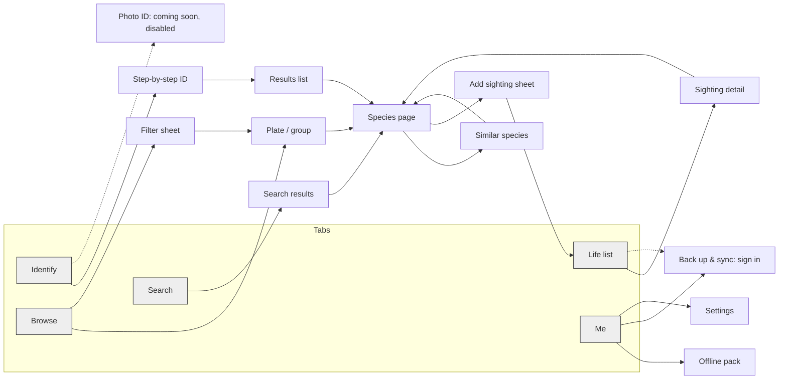
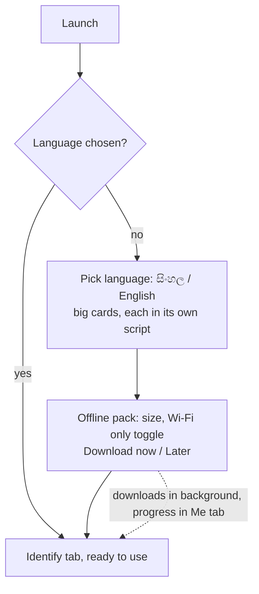
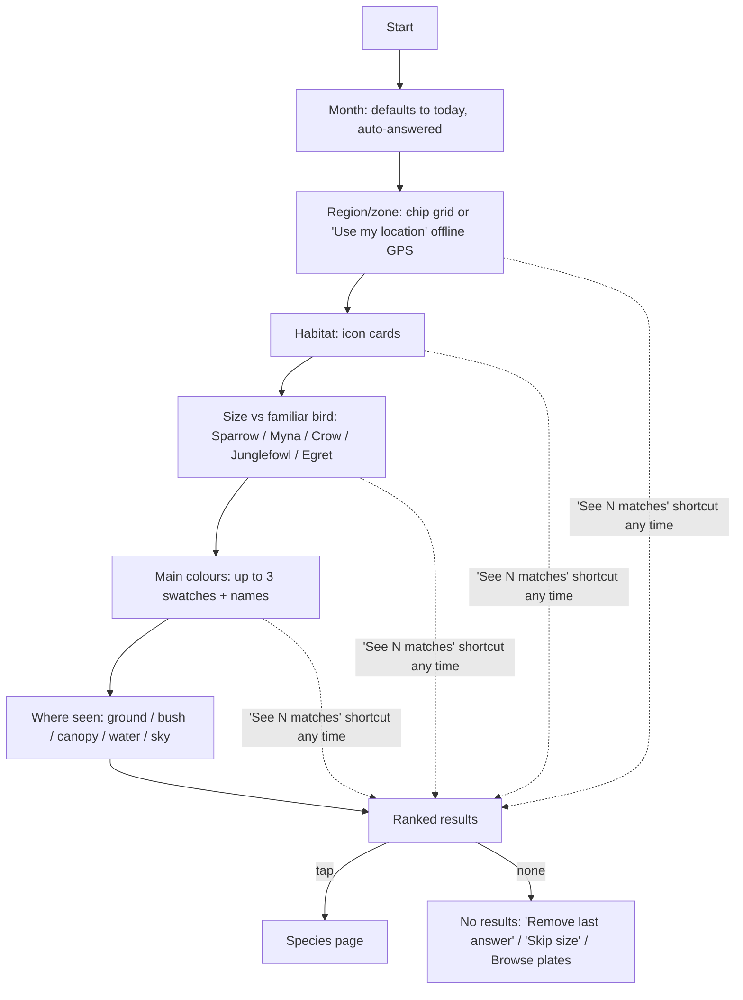
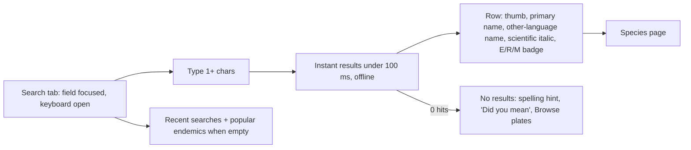
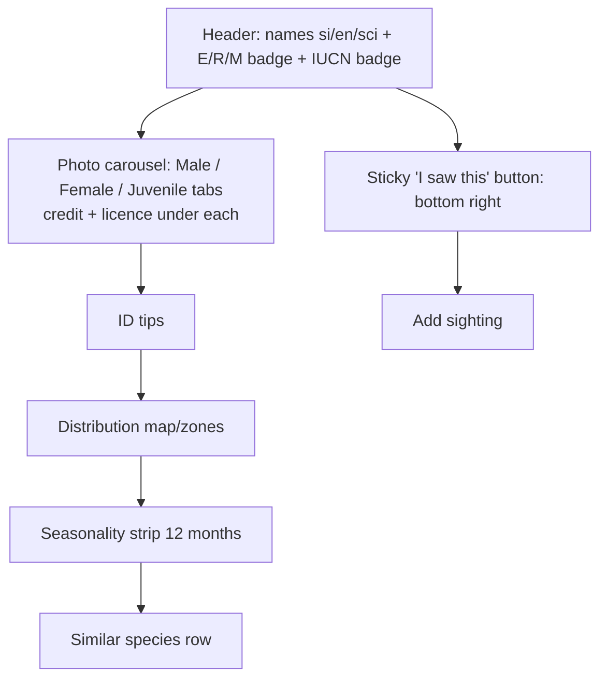
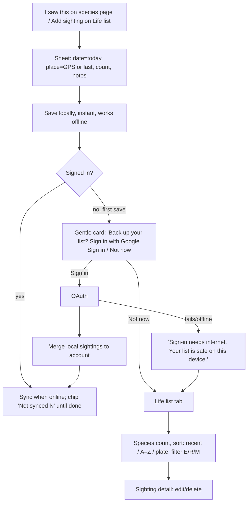

# 01 — UX flows, IA and design foundations (Phase 1: Discover)

Status: Draft, waiting for owner approval. Source: `docs/product/00-decisions.md`.
Wireframes: [`wireframes.html`](./wireframes.html). Mobile first (360 px base), web first, then PWA, then native.

Field context: bright sun, one hand, gloves or binoculars, weak or no signal, low battery.
**Target:** a step-by-step ID finishes in under 30 s.
**Scope (decisions #2 and #7):** Photo ID is *not* in the MVP. It is the next stage, and the MVP shows only a disabled "Coming soon" entry point. There is no sign-in wall. Everything works signed-out and offline, and sign-in is offered only to back up and sync the life list.

## 1. Information architecture

Bottom tab bar (5 tabs, icon plus label, always visible, 56 px tall, thumb zone):

| Tab | Purpose | Login? |
|---|---|---|
| **Identify** (home) | One big *Step-by-step ID* button, search field, recent IDs, disabled *Photo ID: coming soon* card | No |
| **Search** | Instant offline search: Sinhala, English, scientific | No |
| **Browse** | 43 plates/groups plus filters (E/R/M, IUCN) | No |
| **Life list** | Sightings, counts, add sighting. Saved locally. | No (sign-in only to back up/sync) |
| **Me** | Language, offline pack, theme, text size, *Back up & sync (sign in)*, credits/licences | No |

The language toggle (`සිං / EN`) sits in the top app bar on every screen, one tap, with no reload, and it keeps your place and scroll.
Tamil is planned: the toggle is a short list, not a two-way switch, and every string comes from i18n keys.



## 2. Core flows

### 2.1 First launch / onboarding (2 screens, no sign-in)

There is no sign-in step at first launch. Sign-in is first offered after the user saves their first sighting (see 2.6), and it is always available under Me > Back up & sync.
The text, search index and thumbnails ship in the app shell. The full photo pack is optional. The language default comes from the device locale but the user always confirms it.

### 2.2 Step-by-step ID (no more than 5 questions, results update live)

- Each question is one screen. Answers are large tappable cards, and the user can choose *Not sure* (it skips the question and does not filter).
- The sticky footer always shows `See 12 matches ▸`, so the user can stop early (the fastest path).
- Back keeps earlier answers. Answers show as removable chips above the results.
- Month and location are pre-filled, so the realistic path is 3–4 taps.

### 2.3 Photo ID (next stage, not MVP)
The MVP shows only a disabled card on Identify that reads "Photo ID: coming soon" (`aria-disabled`, still focusable, with the text "Coming in a later version"). There is no flow, camera permission or model download in the MVP. The step-by-step results list and the species page are designed so the future Photo ID results ("top 3 with confidence", then Confirm, then Add sighting) can reuse them.

### 2.4 Search

Matching covers English, Sinhala (Unicode, with tolerance for ZWJ/ZWNJ variants), scientific names, and the start of any word. It does not need diacritic-exact input.

### 2.5 Species page

If the male and female look alike, there is one tab labelled "Adult (sexes alike)". If a photo is missing, the placeholder reads "No photo yet". The app never substitutes another species' photo.

### 2.6 Add sighting / life list

- The prompt appears after the first save and again only after a few more saves (owner to set N). It can be dismissed and never blocks anything.
- When signed out, the Life list header shows one quiet line: "Saved on this device only · Back up". Signing out keeps the local copy.

## 3. Login and the signed-out experience
This follows decision #7:
- **Works signed-out and offline:** Step-by-step ID, Search, Browse, Species pages, Life list (local), Settings, Offline pack. There is no sign-in wall anywhere, including at first launch.
- **Needs sign-in:** life list backup and sync across devices only (later also photo uploads). Local sightings merge into the account at sign-in.
- **Entry points:** the post-save card (2.6), the Life list header link, and Me > Back up & sync. The sign-in screen offers Google now and leaves room for Apple (required on iOS when native ships).

## 4. Screen states

| Screen | Loading | Empty | Offline | Error | No results |
|---|---|---|---|---|---|
| Identify home | Skeleton recent list | "No IDs yet" + Step-by-step button | Works fully | — | — |
| Step-by-step Q | None (local) | — | Works fully | Data load failed → Retry | "No birds match": remove last answer / Browse |
| Search | — (instant) | Recents + suggestions | Works fully | Index missing → "Finish offline pack" | "No match for 'x'" + Browse |
| Browse | Skeleton plate grid | — | Works fully | — | Filters exclude all → "Clear filters" |
| Species page | Skeleton blocks | Missing field shows "Not recorded", never a guess | Text works; photos show "Photo not downloaded" + download | Image failed → placeholder + credit kept | — |
| Life list | Skeleton | "Your list is empty. Find a bird to add." | Works; "Not synced (3)" chip if signed in | Sync failed → "Will retry" + Retry | Filter → "No sightings match" |
| Sign-in (backup) | Button spinner | — | "Sign-in needs internet. Your list is safe on this device." | OAuth cancelled/failed → message + Retry; merge conflict → keep both | — |
| Offline pack | Progress bar % + MB | Not downloaded → size + Download | Paused, resumes later | Storage full → shows the space needed | — |

Global: a thin top banner says "Offline — everything works; backup will sync later". It shows once per session and then collapses to an icon.

## 5. Bilingual typography (Sinhala + English, Tamil-ready)
- **Fonts:** Noto Sans Sinhala (Sinhala), Noto Sans (Latin, Tamil later via Noto Sans Tamil). System-font fallback. For the PWA, subset and self-host the fonts so they are cached for offline use. No CDN at runtime.
- **Line-height:** Latin body 1.4, Sinhala body **1.7** (vowel signs sit above and below the base). Headings are 1.3 Latin and 1.5 Sinhala. Set it per script with `:lang(si)`.
- **Size:** Sinhala renders about 1 step larger optically, so it uses the same rem size but never goes below 16 px for body text.
- **No truncation mid-conjunct:** do not use `text-overflow: ellipsis` on Sinhala names. Wrap to 2 lines instead. If a cut is unavoidable, break only at grapheme-cluster boundaries (`Intl.Segmenter`), never inside a ZWJ (U+200D) conjunct such as ක්‍ෂ. Layouts must allow names to wrap.
- **Name order:** the primary name follows the UI language. The second line shows the other language. The scientific name is always shown, in italic (Latin only, never italicise Sinhala).
- **Data:** names are displayed exactly as in the workbook. No transliteration and no machine translation.
- **Toggle:** `සිං | EN` in the top bar of every screen. It switches instantly, is remembered, and is announced by screen readers ("Language: English").

## 6. Accessibility
- WCAG 2.2 AA: text contrast at least 4.5:1, large text and UI parts at least 3:1, in light and dark modes. Badge text is checked against its own fill.
- Touch targets are at least 44×44 pt (48 dp on Android) with at least 8 px gaps. Primary actions sit in the bottom 40% of the screen. WCAG 2.5.8 is met with room to spare.
- **Occurrence badges:** colour is never the only signal. Every badge has an icon plus a letter plus a word:
  `● E Endemic` (green, leaf icon) · `▲ R Resident` (orange, house icon) · `◆ M Migrant` (blue, arrow icon). Shapes differ for colour-blind users.
- IUCN badge: the code as text (`LC`, `NT`, `VU`, `EN`, `CR`) plus the full name in the screen-reader label.
- Dynamic type up to 200% with no clipping. Cards reflow to a single column. Respect `prefers-reduced-motion`.
- Screen readers: images have labels like "Sri Lanka Junglefowl, male. Photo: <credit>". The order is name first, then badges.
- Focus is visible (2 px outline). Results update with `aria-live="polite"`. Nothing depends on swipes alone (the carousel also has tabs).
- Sunlight: high-contrast light theme by default outdoors. No light-grey text on white.

## 7. Dark mode
It follows the system setting and can be overridden in Me. Surfaces use `#121212`/`#1E1E1E`, and the E/R/M colours have lighter dark-mode variants (below) so they keep 3:1 or better. Photos are not dimmed. Dark mode helps battery on OLED screens and at dawn or dusk.

## 8. Minimal design tokens

```yaml
color:
  bg:            { light: "#FFFFFF", dark: "#121212" }
  surface:       { light: "#F4F4F2", dark: "#1E1E1E" }
  text:          { light: "#1A1A1A", dark: "#F2F2F2" }
  text-muted:    { light: "#555555", dark: "#B8B8B8" }   # >= 4.5:1 both
  primary:       { light: "#1F5E3B", dark: "#7FD1A0" }   # actions
  focus:         { light: "#0B57D0", dark: "#A8C7FA" }
  error:         { light: "#B3261E", dark: "#F2B8B5" }
  endemic:       { light: "#1B7A3E", dark: "#6FD08C" }   # green  + leaf + "E"
  resident:      { light: "#B45309", dark: "#FDBA74" }   # orange + house + "R"
  migrant:       { light: "#1D4ED8", dark: "#93C5FD" }   # blue   + arrow + "M"
  # Badge = white text on light fill (>=4.5:1); dark mode = #121212 text on dark fill.
  # Exact hues: match workbook colours once ornithologist confirms them; re-check contrast.
type:            # rem @16px; line-height latin / sinhala
  display:  { size: 1.75, weight: 700, lh: [1.3, 1.5] }   # species name
  title:    { size: 1.25, weight: 600, lh: [1.3, 1.5] }
  body:     { size: 1.0,  weight: 400, lh: [1.4, 1.7] }
  label:    { size: 0.875,weight: 600, lh: [1.3, 1.6] }   # badges, chips
  caption:  { size: 0.8125,weight: 400, lh: [1.35,1.6] }  # photo credit (min 13px)
  scientific: { style: italic, latin only }
space: [0, 4, 8, 12, 16, 24, 32, 48]   # px; screen padding 16
radius: { sm: 6, md: 12, lg: 20, pill: 999 }
size:  { touch-min: 44, tab-bar: 56, app-bar: 56, fab: 56, button-lg: 56 }
```

**Components (reuse first):** App bar with language toggle, Bottom tab bar, Big action card, Answer card (icon + label, also used for habitat, size, colour and position), Chip (answer and filter), Species row, Occurrence badge, IUCN badge, Photo tabs + credit line, Disabled "coming soon" card, Bottom sheet (filter, add sighting), Banner (offline/sync), Empty-state block, Skeleton.

## 9. Open questions for the owner
1. Should the disabled "Photo ID: coming soon" card be shown in the MVP at all, or hidden until it ships?
2. How often should the "Back up your list?" prompt appear (after the 1st save, then every N saves, or once only)?
3. On sign-in, should local sightings always merge silently into the account, or ask first if the account already has data?
4. Region/zone model: wet/dry/intermediate/hill zones, or districts? (ornithologist + workbook)
5. Which "familiar birds" should be the size references, and which colour palette names in Sinhala? (ornithologist)
6. Do exact E/R/M hex values have to match the workbook, or can we tune them for contrast?
7. Offline photo pack size budget (MB), and should Wi-Fi-only be the default?
8. Should sightings store precise GPS or a rounded location? (sensitive-species privacy)
