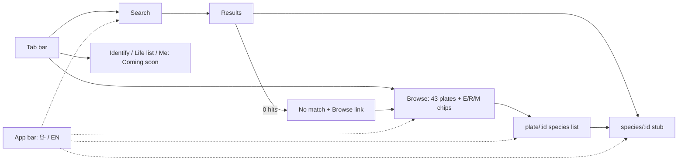

# 001 — Browse and search (M1)
Status: Approved (2026-11-13)

## Problem
Ruwan (guide), Emma (tourist), Nimali (Sinhala-first beginner) and Kasun (student) need to find a Sri Lankan
species fast, by any name they know (Sinhala, English or scientific) or by plate. They often have no signal and
no account. Today the app is a blank scaffold. M1 (prototype plan §7) delivers the signed-out, offline guide
skeleton: a tab shell, a si/en toggle, Browse by plate, instant Search and a minimal species route.
Covers F1, F2, F8 (toggle only) and F9 (occurrence filter only) from `docs/product/01-prototype-plan.md`.

## User stories
- As Ruwan, I want to find a species by English, Sinhala or scientific name, even when I misspell the Latin, so I can answer clients quickly.
- As Nimali, I want the app and bird names in Sinhala, typed with my usual keyboard, so I can use it without English.
- As Emma, I want to browse plates and show only Endemics, so I can see which endemic birds I might meet.
- As Kasun, I want everything to work without data or an account, so I can use it on field trips.

## Acceptance criteria
Shell and language
- Given first load, then a 5-tab bar shows Identify, Search, Browse, Life list, Me (icon + label, 56 px); Identify, Life list and Me show a "Coming soon" placeholder (no Photo ID entry, decision #16).
- Given no saved language, when the app opens, then the language is taken from the device locale (`si*` → si, else en).
- Given any screen, when I tap `සිං | EN` in the app bar, then all UI strings and bird names switch without reload, my route and scroll position are kept, the choice survives a restart, and the screen reader announces "Language: English" / Sinhala equivalent.
- Given si is active, then the root has `lang="si"` and Sinhala body text uses line-height 1.7 and is never below 16 px.

Browse
- Given the Browse tab, then 43 plates are listed in `plate_number` order, each with its number and title in the UI language.
- Given I open a plate, then its species are listed in `plate_order` order; each row shows primary name (UI language), other-language name, italic scientific name and the occurrence badge.
- Given I select the Endemic filter chip, then the plates list shows only plates containing an Endemic species, with a matching count, and an opened plate lists only matching species; the filter state is kept between plates list and plate.
- Given a species with a compound code (`R/M`, `R+M`, `R+(M)`), then its badge shows the exact code, and it matches both the Resident and the Migrant filters (owner decision).
- Given filters that match nothing on a plate, then I see "No species match these filters" and a "Clear filters" button.

Search
- Given the Search tab, then the field is focused; with an empty query it shows a short hint ("Type a name in Sinhala, English or Latin") and a link to Browse.
- Given airplane mode after first load, when I type "Sri Lanka Junglefowl", then `slb-gallus-lafayettii` is the first result.
- Given I type "Gallus laf" or "lafay", then the species appears (word-prefix on scientific names).
- Given I type "Galus lafayetii" (one typo per word; ADR 0006 caps: distance 1 for 4–6 chars, 2 above), then the species appears in the top 5 (fuzzy, Latin script only).
- Given I type a Sinhala name with or without ZWJ/ZWNJ, or in a non-NFC composition, then the same species are found and the name is displayed exactly as in `content.json` (byte-identical).
- Given I type a Sinhala prefix, then prefix/substring matches appear; no fuzzy matching is applied to Sinhala.
- Given each keystroke, then results update in under 100 ms on a mid-range Android profile (perf test over all 295 × 3 names) and are announced with `aria-live="polite"`.
- Given no match, then I see "No match for '<query>'" and a link to Browse plates (no link to step-by-step ID until it exists).

Species detail stub
- Given I tap a species row, then `/species/<species_id>` shows names (si, en, scientific italic), the plate title in the UI language (English fallback), the occurrence badge (icon + letter + word) and the IUCN badge labelled "Global status (working value)"; nothing else.
- Given `names.si` or `iucn_category` is null, then that field reads "Not recorded"; nothing is inferred.
- Given an unknown species id in the URL, then I see "Species not found" and a link to Search.

Cross-cutting
- Given text size 200% (browser zoom / OS dynamic type), then no name, badge or tab label is clipped; long Sinhala names wrap to 2+ lines and are never ellipsised.
- Given any badge, then colour is not the only signal and contrast is ≥ 4.5:1 in light and dark themes.
- Given the device is offline after the first load, then every M1 interaction works with no network request (asserted in Playwright).

## UX
Screens and states: `docs/design/01-ux-flows.md` §1 (tabs), §2.4 (Search), §4 (states), §5 (typography), §6 (a11y), §8 (tokens);
wireframes: `docs/design/wireframes.html`. Routes per ADR 0002: `(tabs)/index` (Identify, at `/`), `(tabs)/search|browse|life-list|me`, `plate/[id]`, `species/[id]`.

## Data
Fact: `content/content.json`, schema `src/shared/data/content-schema.ts` (`schema_version: 1`).
- `plates[]`: `plate_id`, `plate_number`, `title.en`, `title.si` (nullable).
- `species[]`: `species_id`, `plate_id`, `plate_order`, `names.en`, `names.si` (nullable), `names.scientific`, `occurrence_code`, `iucn_category` (nullable).
- Bundled into the JS build (no fetch), read only via `shared/data`; schema validated in a Jest test and the content CI step, not at runtime.
- Search keys are derived at load by the pure key function (ADR 0006); stored values are never changed.

Missing / not supported by current data:
- Alternate or colloquial Sinhala names (no `Name` rows yet) — ornithologist to supply; M1 searches primary names only.
- Thumbnails/images — none licensed; rows have no image (F7/M3).
- Tamil names — later (F17).
- File name differs from ADR 0006 (`content.v{N}.json` + `manifest.json`); M1 reads `content.json` as delivered.

## Out of scope
Full species page (prose, images, sources: M2), IUCN filter, recent searches and "popular endemics", "Did you mean",
step-by-step ID, life list, sign-in, Me/settings screens, first-launch language picker, theme override, service worker /
reload-while-offline and PWA install (Next stage), Tamil, native builds.

## PR slices
Each leaves `main` green (typecheck, lint, Jest) and the app runnable.
1. Design tokens + theme — `shared/theme/tokens.ts` from UX §8, `useTheme()` (system light/dark), self-hosted Noto Sans + Noto Sans Sinhala via `expo-font`, tests (~150)
2. i18n `t()` + language setting — `shared/i18n` (`t(key, vars)`, `Intl.PluralRules`, en/si JSON with key-parity type check), `Settings` context, persistence adapter in `shared/platform`, `expo-localization` default, root `lang` (~180)
3. App shell + tab bar — `(tabs)` layout with 5 tabs, app bar with `සිං | EN` toggle, "Coming soon" placeholder for Identify/Life list/Me, `OccurrenceBadge`/`IucnBadge`/`SpeciesRow` in `shared/ui` (~190)
4. Content access module — bundle `content.json`, `shared/data` typed accessors (`getPlates`, `getPlate`, `getSpecies`, `speciesByPlate`, occurrence index), zod schema test against the real file (~120)
5. Search key + index (pure) — NFC, ZWJ/ZWNJ strip, Latin lowercasing/diacritics, code-point prefix, word-prefix, capped Damerau-Levenshtein for Latin; table tests incl. all acceptance queries + perf test (~190)
6. Search screen — `(tabs)/search`, focused field, instant results, empty/no-result states, `aria-live` (~140)
7. Browse plates — `(tabs)/browse` plate list in UI language, E/R/M filter chips with counts, filter state in route params, pure `matchesOccurrence()` with tests (~150)
8. Plate species list — `plate/[id]` ordered by `plate_order`, filters applied, "Clear filters" empty state, unknown plate state (~110)
9. Species detail stub — `species/[id]`: names + badges, "Not recorded", not-found state (~90)
10. Playwright offline smoke + CI — web export, `setOffline(true)` after first load, search en/si/scientific, browse→plate→species, toggle language, 200% zoom no-clip check; `npm run test:e2e` in CI (ADR 0005) (~150)

## Decisions (owner, 2026-11-13)
1. Compound codes `R/M`, `R+M`, `R+(M)` match both the Resident and Migrant filters; the badge shows the exact code.
2. Offline in M1 = works offline after first load. Offline reload comes with the service-worker slice (ADR 0004) right after M1.
3. All 295 species have a Sinhala name today; if one is ever null in Sinhala mode, the English name becomes the primary line.
