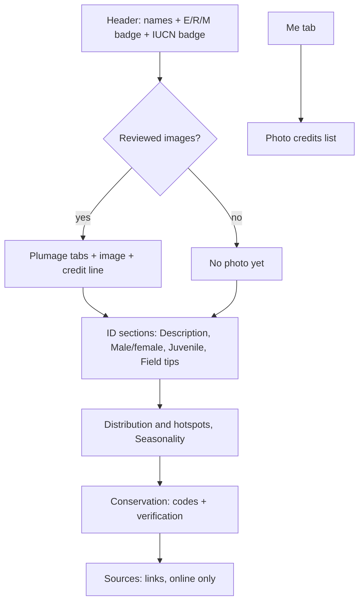

# 003 — Species page (M2)
Status: Approved (owner, 2026-11-14)

## Problem
Nimali (Sinhala-first beginner), Emma (tourist), Kasun (student) and Ruwan (guide) open a species and get only
names and two badges (spec 001 stub). They cannot read how to identify it, where and when it occurs, how sure the
status values are, or see what the male, female and young look like. M2 (prototype plan §7, merging M2 and M3)
turns the stub into the full F3 page with F7 (licence register). It has to work offline, never invent data, and
credit every image. Images are delivered for a **pilot of ~20 species**, then scaled in M8.

## User stories
- As Nimali, I want to see the male, female and young side by side, so I can match the bird I saw.
- As Nimali, I want the text in Sinhala, or a clear note when it only exists in English, so I know what I am reading.
- As Emma, I want ID tips, distribution and seasonality offline, so I can check a bird in Yala with no signal.
- As Ruwan, I want the status codes, verification state and sources, so I can judge how far to trust the page.
- As the owner, I want every image to have a reviewed licence and visible credit, so the private MVP is clean to clear before launch.

## Acceptance criteria
Text (Identification and Distribution prose)
- Given any species, then the sections appear in this order: Description, Male and female, Juvenile, Field tips, Distribution and hotspots, Seasonality. Each is shown exactly as in the workbook, byte-identical.
- Given a section whose text language differs from the UI language, then the text is still shown, with a `lang` tag for its own language (so Sinhala keeps line-height 1.7), and a notice above it says "Not yet available in <UI language>". [Fact] ~267 species are English-only and ~28 are Sinhala-only.
- Given a blank cell, or a cell on the reviewed placeholder list (e.g. juvenile "not obtained in this pass", ~20 cells), then the section reads "Not recorded". It never reads "same as adult" or any inferred text.
- Given the UI language changes, then section headings and notices switch and the prose itself is unchanged.

Conservation and sources
- Given any species, then the page shows the occurrence code exactly (e.g. `R+(M)`) and its verification status, plus the IUCN category labelled "Global status (working value)" and its verification status. A blank value reads "Not recorded".
- Given a BirdLife factsheet URL or Species Sources rows, then they are listed as links with the domain visible. They open in the system browser.
- Given I am offline, when I tap a source link, then I see "This link needs an internet connection" and stay on the page. Nothing else on the page needs a network.

Photos (pilot species)
- Given a species with reviewed images, then a gallery shows one tab per plumage that has an image, in this order: Male, Female, Adult (sexes alike), Juvenile/Immature, Breeding, Non-breeding, Eclipse, Morph. Swiping is optional because the tabs are buttons.
- Given any rendered image, then a credit line is always visible under it: "Photo: <author> · <licence short name> · <source site>". Licence and source are links. No image is ever rendered without its credit.
- Given an image, then its alt text is "<species name in UI language>, <plumage label in UI language>. Photo: <author>".
- Given a plumage with no reviewed image, then that tab is hidden. Given a species with no reviewed images (~275 of 295 in M2), then one block reads "No photo yet". There is never a broken image, a search link shown as content, or another species' photo.
- Given the build, when an image file has no `reviewed` register row (or a reviewed row has no file), or a licence is outside the allow-list, or a full image is over 200 KB, then CI fails (ADR 0004).

Offline
- Given the app was opened once online, then every pilot thumbnail is precached and shows offline, and total precache stays ≤ 10 MB.
- Given I viewed a full image online, when I reopen it offline, then it loads from the `photos-v1` CacheFirst cache.
- Given I am offline and a full image was never cached, then the slot shows the species thumbnail (if that plumage) or "Photo not downloaded", with the credit line kept.
- Given airplane mode after first load, then text, conservation and the gallery tabs work with no failed request (Playwright).

Accessibility and language
- Given 200% text size, then no heading, notice, credit or tab is clipped. Credits are ≥ 13 px. Sinhala is never ellipsised.
- Given a screen reader, then the order is name, badges, gallery (tab name + selected state), sections. The language notice is read before the prose it describes.

Credits
- Given Me → Photo credits, then every shipped image is listed with species name, plumage, author, licence (with link) and source link, grouped by species. The list works offline.

## UX
Layout and states: `docs/design/01-ux-flows.md` §2.5, §4 (species page row), §5, §6. Wireframe: `docs/design/wireframes.html`.
`ui-ux-designer` updates the species wireframe with the language notice, credit line, "No photo yet" and the
sources list, and removes the Similar species row, the map and the 12-month strip (none have data yet, see Data).

## Data
Facts (workbook v1.0):
- Identification: description, male/female, juvenile, field tips. Distribution: distribution and hotspots, seasonality. Each species is in one language only.
- ~20 juvenile cells are placeholders ("not obtained in this pass", ornithologist flag F3).
- Conservation: occurrence code, IUCN (working), verification statuses, BirdLife factsheet URL. Species Sources: 347 URLs.
- Media: 1,770 slots, all `asset_url` blank, search links only. There are no images.

Build changes (ADR 0006):
- `SpeciesText {species_id, field, lang, text}`. `lang` is tagged by script: `si` when at least 20% of the cell's letters are Sinhala, `en` when there are none (and at least one Latin letter). Anything in between, or a cell with no letters, is ambiguous and fails the build unless listed in `data/content/text-lang-overrides.csv`. Latin terms inside Sinhala prose are normal and do not make a cell ambiguous.
- Placeholder cells are listed in `data/content/text-placeholders.csv` (species_id, field), reviewed by the ornithologist. They import as null and the source is unchanged.
- [Assumption] Prose, conservation details and sources go in a separate `content/species-text.json`. It is lazy-loaded and precached, because ~0.9 MB raw (~250 KB gz, ADR 0006) inside the bundle would break the 450 KB initial-JS budget. Slice 1 measures and confirms this. `schema_version` 3 applies to `species-text.json` only (v2 was prose only; v3 adds conservation and sources); `content.json` stays at 1.
- Media: `data/content/media/licences.csv` (ADR 0004 columns) → masters → thumb/full + `media-manifest.json` → `MediaAsset`.
  The `plumage_key` comes from 02 §3. CC BY-NC rows are allowed (decision #18), are derived as "replace before launch" from the licence, and are counted in the validation report.

Missing data and who supplies it:
- Images: 0 exist. The ornithologist proposes candidate images per slot from Commons/iNaturalist with licence, and the owner reviews. Only `reviewed` rows ship.
- Pilot list (~20): the ornithologist's 10 trait-pilot species (02 §4) plus ~10 more, chosen for diversity: endemics, marked dimorphism, juvenile-distinct, seasonal plumage, migrants. Owner approves.
- Per-slot "No image yet" tabs would need reviewed `dimorphism`/`juvenile_distinct` flags (~2 reviewer-days, 02 §5). Until then, missing plumages are hidden.
- Translations: none. No machine translation. Reviewed translations later become extra `SpeciesText` rows.
- Sinhala UI labels for plumage terms (male, juvenile, eclipse…) need a human-reviewed glossary (ornithologist + owner).
- [Assumption] The Species Sources title/label column has to be confirmed in slice 3. If there is none, the link shows the domain.

## Out of scope
- **Similar species.** The data does not support it. The confusion groups (02 §6) are an unreviewed proposal, list English names rather than `species_id`s, and have no "how to tell apart" text. It needs a reviewed `confusion_group_id` trait (M5/M8).
- **Distribution map, zone chips and the 12-month strip.** Prose only today. They need reviewed `zone`/`month_presence` traits (M5).
- Images for the other ~275 species (M8), and "Download offline pack" (see Q2).
- Thumbnails in search and browse rows. Taxonomy names, long conservation and source notes. "I saw this" (M6). Translations, Tamil, and illustrations from the Media sheet.

## PR slices
Each slice leaves `main` green. Code (C) lands before UI. Data PRs (D) carry only register rows, lists or image files.
`[Orn]` = ornithologist drafts or reviews. `[Owner]` = owner review needed before merge.
1. C feat(content): import prose as `SpeciesText` with script `lang` tag into lazy `species-text.json`, schema v2 (species-text.json), ambiguous-language check, empty placeholder list, bundle-size check (~180)
2. D data(content): placeholder cell list (~20 juvenile + any others) [Orn] (~25)
3. C feat(content): add conservation details (verification statuses, factsheet URL) and Species Sources to `species-text.json`, with validation (~140)
4. C feat(media): licence register schema and CI validator (allow-list, status, FK to species/plumage_key, file↔row parity, NC count). Empty register (~180)
5. C feat(media): `tools/content/media` with sharp. Master ingest (EXIF strip, 1600 px), thumb/full generation, `media-manifest.json`, size budgets in CI (~180)
6. C feat(species): prose sections with language notice, `lang` tags, "Not recorded", lazy load with skeleton [Orn: section labels] (~170)
7. C feat(species): conservation block and sources list, opened in the browser, offline link notice (~140)
8. D data(media): pilot species list + `proposed` register rows with candidate URLs and licences [Orn] [Owner] (~45 rows; can start after 4)
9. D data(media): set approved rows to `reviewed`, add masters, generated thumb/full and manifest [Orn] [Owner] (binary + ~45 rows)
10. C feat(species): photo gallery (plumage tabs, credit line, alt text, hidden/missing states, Sinhala plumage labels) [Orn: labels] (~190)
11. C feat(pwa): precache thumbnails, `photos-v1` CacheFirst runtime cache, offline fallback, e2e offline gallery test (~120)
12. C feat(me): Me → Photo credits list from the manifest, offline (~120)
13. C feat(me): Me → "Download offline photo pack": shows size, Wi-Fi hint, progress and resume; fills `photos-v1` from the manifest; `navigator.storage.persist()`; e2e (~170)

## Decisions (owner, 2026-11-14)
1. **Pilot list**: the ornithologist picks ~20 (the 10 trait-pilot species + ~10 for diversity: endemics, sexually dimorphic, distinct juveniles, seasonal plumage, migrants). The owner approves the list in PR 8.
2. **Licences**: prefer CC0 / CC BY / CC BY-SA when a comparable image exists; CC BY-NC only when nothing else fits, flagged "replace before launch".
3. **Offline photo pack**: ships in M2 (slice 13) for the pilot images.
