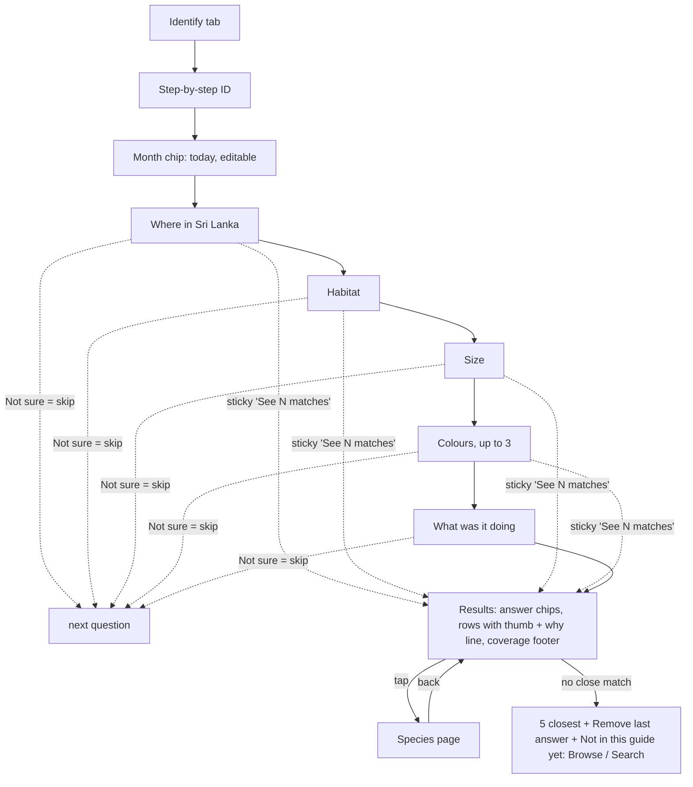

# 004 — Step-by-step ID (M5)
Status: Approved (owner, 2026-11-16)

## Problem
Nimali (Sinhala-first beginner), Emma (tourist) and Kasun (student) see a bird they cannot name. They do not know
which plate to browse or what to search for. Today the Identify tab is "Coming soon" (`src/app/(tabs)/index.tsx`).
M5 (prototype plan §7) adds F4: a few simple, skippable questions that produce a ranked shortlist of species,
offline and signed-out, for a **pilot of ~30 common species**. It must never force a match. When the bird is not in
the pilot, the app says so and points to Browse and Search. The workbook has no structured traits, only prose
(plan §5), so M5 also builds the reviewed trait data the ranking needs. Scaling to all 295 species is M8.

## User stories
- As Emma, I want to answer a few questions with pictures, so I can narrow down a bird without knowing any names.
- As Nimali, I want the questions and answers in Sinhala, so I can identify a bird without English.
- As Kasun, I want to skip any question I am unsure about, so a wrong guess does not hide the right bird.
- As Emma, I want to see the matches at any point, so I can stop after two or three answers.
- As Ruwan, I want to see why a species matched and when data is incomplete, so I can judge the result.
- As the owner, I want only reviewed trait values to drive results, so the app never ranks on unchecked data.

## Acceptance criteria
Flow
- Given the Identify tab, then it shows one large "Step-by-step ID" button (no Photo ID entry, decision #16).
- Given I start, then the month is pre-set to today's month and shown as an editable chip. The questions follow in
  order (02 §1): Where in Sri Lanka (6 zones), Habitat (5), Size vs familiar birds (7 classes), Main colours (up to 3
  of 12), What was it doing (6). Each question is one screen with a "Not sure" option.
- Given any question, when I tap "Not sure", then it advances and that question adds no points and removes none.
- Given any question after the first, when I tap Back, then the previous question shows my earlier answer selected.
- Given any question, then a sticky footer shows "See N matches", and N updates after each answer.
- Given I pick a 4th colour, then it is not added and the screen says "Up to 3 colours".
- Given every question is skipped, then "See N matches" lists all pilot species, ordered by month fit and then by the
  agreed tie-break (Q4), with no species missing.

Ranking (pure engine, unit-tested)
- Given any set of answers, then no single mismatch removes a species. Each species is scored (02 §2 soft scoring).
- Given a size answer, then the same class scores fully and an adjacent class scores partly.
- Given colours, then they match against every reviewed plumage of the species (male, female, juvenile, breeding…).
- Given a migrant with `month_presence = absent` for the chosen month, or a species not in the chosen zone, then it
  ranks below otherwise-equal species and its result says "Not usually here/now". It stays in the list.
- Given two species that differ only in occurrence code (E/R/M…) or IUCN, then they get the same score.
- Given a trait with no reviewed value, then it is neutral and the result shows "Data incomplete".
- Given the build, then only `review_status = reviewed` trait rows reach the app.
- Given the ornithologist's scenario set (~20 sightings, Data), then the target species ranks in the top 5 for at
  least 80% of scenarios and in the top 3 for each of the 5 demo birds. [Assumption: targets for owner to confirm, Q5]

Results
- Given results, then each row shows a thumbnail (from `getSpeciesImages` + `mediaUrl`, or "No photo yet"), primary
  name in the UI language, other-language name, italic scientific name, occurrence badge, and a "why" line, e.g.
  "Size ✓ · Colours ✓ · Not usually here in July".
- Given results, then my answers show as chips above the list. Removing a chip re-ranks immediately.
- Given I tap a result, then the species page `/species/[id]` opens. When I go back, my answers and the list are unchanged.
- Given answers where no species scores as a match, then I see "No close matches", the 5 closest species, "Remove last
  answer", and "Not in this guide yet?" with links to Browse and Search.
- Given any results list, then its end shows "This guide can identify 30 of 295 species so far" with Browse and Search links.
- Given the list is computed, then results appear within 1 s of tapping "See N matches" on a mid-range Android
  profile (perf test; ranking alone is expected to take under 10 ms).

Offline, language, accessibility
- Given airplane mode after first load and no account, then the whole flow and results work, with no failed request (Playwright).
- Given a pilot thumbnail that was precached, then it shows offline. If it was not precached, the row shows "No photo yet" and no broken image.
- Given si is active, then every question, answer label, chip, "why" line and empty state is in Sinhala from
  reviewed i18n keys. Bird names display exactly as in the content (byte-identical) and are never ellipsised.
- Given a screen reader, then each question heading gets focus on arrival. Answers are radio buttons (checkboxes for
  colours) with text labels. Colour swatches always have a visible name. N is announced with `aria-live="polite"`.
- Given 200% text size, then answer cards reflow to one column with no clipping. Touch targets are ≥ 48 dp.

Demo (M5)
- Given airplane mode, signed out, then the 5 demo birds (chosen by the ornithologist from the pilot) each appear in
  the top 3 using their scripted answers (e2e).

## UX
Source: `docs/design/01-ux-flows.md` §2.2, §4 (Step-by-step row), §6. Wireframe: `docs/design/wireframes.html`.
`ui-ux-designer` updates the wireframes to match 02 §1 before slice 6. Today §2.2 lists 5 size birds and 5 positions,
while 02 has 7 size classes and 6 positions. This spec follows 02 (ornithologist). The designer also adds the "why" line,
the "Not in this guide yet" block, and the coverage footer. Out of M5: the "recent IDs" list and the search field on Identify home.

## Data
Facts (workbook v1.0 and repo):
- No structured traits exist. Length, colours, habitat, distribution and seasonality are prose only, mostly English (plan §5, 02 §7).
- ~17 rows have no parseable length (02 F2). Seasonality comes from the workbook, not eBird (decision #14).
- 20 species already have reviewed photos (`data/content/media/pilot-species.csv`, spec 003). `SpeciesRow` has no thumbnail today.

Build changes (ADR 0002, 0006):
- Input `data/content/traits.csv`, one value per row: `species_id,trait,value,plumage_key,source,confidence,review_status,note`.
  `trait` is `zone`, `habitat`, `size`, `colour`, `behaviour`, `month` or `commonness`. Vocabularies are in
  `src/shared/data/traits-vocabulary.ts`. `size` is one row per class (XS to XXXL) that the length range touches, not
  centimetres. `behaviour` is the field the design doc calls `where_seen`. `month` is `all` or one row per month 1 to 12.
  `commonness` is `<zone>:<level>`. `plumage_key` (colour and size only) is blank, a plumage name or `morph_<name>`.
  `review_status` is `proposed`, `reviewed` or `rejected`.
- `tools/content` validates the rows and writes `content/traits.json` (`schema_version`, `species` keyed by id, each a
  `SpeciesTraits`), separate from `content.json` and the workbook. The validator fails on any row, whatever its status:
  unknown species_id or trait, a value outside the vocabulary, a blank `source`, a bad `confidence`/`review_status`/
  `plumage_key`, `all` mixed with months 1 to 12, more than 3 colours for one plumage, proposed and reviewed rows mixed in one
  month list or one plumage's colours or sizes, a blank and a named `plumage_key` mixed, a reviewed commonness without a
  reviewed zone (proposed commonness needs any non-rejected zone), or a duplicate row (rejected rows are skipped). Months expand to 12 `present`/`absent` entries. A trait with no reviewed rows is
  left out of the species entry (unknown). Only `reviewed` rows are written. The report counts rows by `review_status`.
- The ranking engine is `src/features/identify/rank.ts` (pure, no I/O). Traits are read through `src/shared/data`.

Missing data and who supplies it:
- Pilot list (~30): the ornithologist proposes it and the owner approves it (Q1). [Assumption] Use the 20 photo-pilot
  species, plus ~10 very common birds that include the size references from 02 §1 (e.g. House Sparrow, Red-vented
  Bulbul, Great Egret, a white-eye, Black Kite), so the size question has pictures that match real results.
- Trait rows for the pilot: the ornithologist drafts them from the workbook (`wb:` sources) and marks field knowledge
  `[X]` as low/medium confidence. The owner reviews them (decision #9). Only reviewed rows ship.
- Scenario set: ~20 realistic sightings (month, zone, answers, expected species) plus the 5 demo birds, from the ornithologist.
- Sinhala labels for zones, habitats, the 12 colours, size references and positions: a glossary drafted by the
  ornithologist and reviewed by the owner. No machine translation.
- Commonness tie-break: 02 §2.5 used eBird frequency, which decision #14 rules out for now. Needs an owner decision (Q4).
- Zone polygons for "Use my location": need a licensed source (02 §1). Not available, see Q2.

## Out of scope
- Photo ID (hidden, decision #16), Sound ID, sightings and "add to life list" (M6), sign-in (M7).
- Trait coverage beyond the pilot, and images for non-pilot species (M8).
- Confusion-group cards (02 §2.7) and "more detail" chips (bill, tail), because there are no reviewed `confusion_group_id` values.
- `commonness_by_zone`, `sensitivity`, `juvenile_distinct`, `seasonal_plumage` traits. Distribution map and 12-month strip on the species page.
- Weight tuning beyond the scenario set, and any GPS use (pending Q2). Recent IDs on Identify home.

## PR slices
Each slice leaves `main` green. Code (C) lands before UI. Data (D) PRs carry only CSV rows. Slices 4 and 6–8 use
fixture traits, so they do not wait for data. `[Orn]` = ornithologist drafts or reviews. `[Owner]` = owner review before merge.
1. C feat(content): trait vocabulary types, `traits.csv` → `traits.json` with validation and report counts, empty CSV (~180)
2. D data(traits): pilot list + `proposed` trait rows + scenario set and 5 demo birds [Orn] (~30 species, ~700 rows)
3. D data(traits): reviewed rows set to `reviewed`, corrections applied [Orn] [Owner] (rows only)
4. C feat(identify): pure `rank.ts` (soft scoring, size adjacency, any-plumage colours, season/zone down-weight,
   neutral unknowns, why-reasons) with unit tests on fixtures; E/R/M and IUCN invariance test (~190) [Orn: weights]
5. C test(identify): scenario tests on real reviewed traits (top-5 ≥ 80%, demo birds top 3) and perf test (~100) — after 3
6. C feat(identify): Identify home button, question screens (month chip, zone, habitat, size) with Not sure, Back,
   sticky "See N matches", answers in route params, en/si keys (~190) [Orn: labels] [Owner: Sinhala glossary]
7. C feat(identify): colour (up to 3, named swatches) and "what was it doing" questions, a11y roles and focus (~150)
8. C feat(identify): results screen: `SpeciesRow` thumbnail variant, why line, removable answer chips, "No close matches",
   "Not in this guide yet", coverage footer, back keeps answers (~190)
9. C test(e2e): offline, signed-out demo: identify 5 demo birds in the top 3, no failed requests (~120) — after 3

## Decisions (owner, 2026-11-16)
1. **Pilot list**: the 20 photo-pilot species plus ~10 common birds (incl. the size-reference birds), drafted by the ornithologist; the owner approves the trait rows in slice 3.
2. **Zone**: chips only in M5; no "Use my location" (needs a licensed zone map; decision #12).
3. **Results**: pilot species only; the coverage footer and Browse/Search links cover the rest.
4. **Ties**: the ornithologist adds a reviewed per-zone commonness rating (no eBird, decision #14).
5. **Target**: correct species in the top 5 for ≥ 80% of test sightings; each demo bird in the top 3.
