# 005 — Life list, local-only (M6)
Status: Approved (owner, 2026-11-18)

## Problem
Emma (tourist), Kasun (student) and Ruwan (guide) want to record the birds they have seen and count their endemics.
They want to do this in the field, offline, without an account. Today the Life list tab is "Coming soon"
(`src/app/(tabs)/life-list.tsx`), and the species page has no way to record a sighting. M6 (plan §7) adds F5: sightings
saved on the device only, signed-out, that survive a restart. The schema is ready for M7 sync (ADR 0003), but M6
builds no sync, sign-in or backup prompt. Demo: add a sighting offline, restart the app, the list is intact, and the
endemic count is correct.

## User stories
- As Emma, I want to tick a bird from its species page in two taps, so I can log it before it flies off.
- As Emma, I want to see "Endemics N of 35", so I know how many Sri Lankan endemics I still need.
- As Ruwan, I want one row per species with first seen, last seen and number of sightings, so my list stays readable.
- As Kasun, I want to add another sighting of a bird I already have, so I can record each trip without duplicate ticks.
- As Nimali, I want the whole list in Sinhala, so I can keep it without English.
- As any user, I want to fix or delete a sighting, so my list stays correct.
- As any user, I want my sightings to stay on my phone and not be shared, so my birding spots stay private.

## Acceptance criteria
Add sighting (species page)
- Given any species page, then a sticky "I saw this" button (≥ 48 dp) opens the Add sighting sheet.
- Given the sheet opens, then the date is today, and place, zone, count and note are empty. Only the date is required.
- Given the date control, then I can choose Today, Yesterday or another past date. Future dates cannot be chosen.
- Given the place field, then it accepts free text up to 80 characters. The zone is an optional single chip from the
  6 identify zones (reviewed labels from M5). No GPS is read and no location permission is requested (Q1).
- Given the count field, then it is empty or a whole number from 1 to 999. Any other value shows an inline error and Save is disabled.
- Given the note field, then it accepts up to 500 characters.
- Given I tap Save, then the sheet closes and "Saved on this device" is shown. The sighting appears in the Life list
  without a reload. This works offline and signed-out.
- Given the species already has sightings, then the page shows "Seen N times · last <date>" and the button reads
  "Add another sighting". Saving adds a sighting. The life list still has one row for the species.
- Given the step-by-step results, when I tap a result and then "I saw this", then the sighting is saved and Back returns
  to my unchanged results. There is no separate button on result rows (Q3).

Life list tab
- Given no sightings, then I see "Your list is empty. Find a bird to add." with links to Identify and Search.
- Given sightings, then a summary card shows species, "Endemics N of 35" and sightings. 35 is counted from content
  where `occurrence_code = 'E'` and is never hard-coded.
- Given sightings, then the summary expands to per-code counts using the exact codes (E, R, M, R/M, R+M, R+(M)).
- Given sightings, then there is one row per species with thumbnail, names, occurrence badge, "First <date> · Last
  <date> · N sightings" and the last place name if set.
- Given the sort chips, then Recent (last seen, newest first) is the default, and A–Z and By plate (`plate_order`) are offered.
- Given the occurrence filter (reusing the Browse filter), when nothing matches, then I see "No sightings match" and "Clear filters".
- Given the header, then one quiet line reads "Saved on this device only". There is no sign-in link or backup card (M7).
- Given I tap a row, then the species page opens on its "Your sightings" section.

Sighting detail, edit, delete
- Given the species page has sightings, then "Your sightings" lists them newest first, with date, place, zone, count and note.
- Given I tap Edit, then the same sheet opens with the saved values. Save updates the row and sets `updated_at`.
- Given I tap Delete and confirm, then the sighting disappears everywhere. It is soft-deleted (`deleted_at` set) and
  is never returned by the list. If it was the species' last sighting, the species leaves the list and the counts.
- Given Me > "Delete all sightings on this device" (Q2), when I confirm by typing or tapping twice, then the list is
  empty. Rows that were never synced (all rows in M6) are removed from storage, not just hidden.

Persistence, offline, storage errors
- Given airplane mode after first load, signed-out, when I add 3 sightings (2 endemics) and reload the page or relaunch
  the app, then all 3 sightings and "Endemics 2 of 35" are still there, with no failed request (Playwright).
- Given the web app's first save, then `navigator.storage.persist()` is requested once. A refusal does not block saving.
- Given IndexedDB cannot be opened (storage disabled, some private-browsing modes), then the app uses an in-memory store
  and shows a banner: "This browser isn't saving your list. Sightings will be lost when you close it." Everything else works.
- Given a save fails (for example, the quota is exceeded), then the sheet stays open with my input and shows
  "Couldn't save. Your device may be out of space." and Retry. Nothing is half-saved.
- Given stored rows fail the shape check on read, then those rows are skipped and logged in dev. The rest of the list loads.
- Given a sighting whose `species_id` is no longer in the content, then its row shows the id and "No longer in this
  guide". It is never dropped (ADR 0006).
- Given migration `0001_init`, then a test opens an empty store, migrates it and confirms the version. Each later
  migration test opens the previous version's fixture and confirms the data survives.

Scale, language, accessibility
- Given 2,000 sightings over 295 species, then the Life list renders within 1 s on the mid-range Android profile.
  Aggregation is a pure function, and the list is virtualised.
- Given si is active, then every label, date, empty state and error is from reviewed si keys. Month names come from
  i18n keys, not `Intl`. Bird names, place names and notes display byte-identical and are never ellipsised.
- Given a screen reader, then the sheet traps focus and every field has a visible label. Save and Delete results are
  announced (`aria-live="polite"`). The summary counts are read as text, for example "2 of 35 endemics".
- Given 200% text, then the summary, rows and sheet reflow with no clipping. Touch targets are ≥ 48 dp.

## UX
Sources: `docs/design/01-ux-flows.md` §2.5, §2.6 and §4 (Life list row), and `docs/design/wireframes.html` frames 5 and 6.
Before slice 6, `ui-ux-designer` updates frames 5 and 6 for M6. Frame 5 loses GPS and the sign-in card, and gains the
zone chip and the date control. Frame 6 loses "Back up", and gains first/last/N on each row and the per-code summary.
The designer also adds "Your sightings" on the species page and the storage-blocked banner.

```mermaid
flowchart TD
  SP[Species page] -- I saw this / Add another --> AS[Sheet: date=today, place?, zone?, count?, note?]
  R[ID results] -- tap --> SP
  AS -- Save, local, offline --> T[Toast: Saved on this device] --> SP
  AS -- save fails --> E[Error + Retry, input kept]
  L[Life list tab] --> SUM[Summary: species · Endemics N of 35 · sightings · by code]
  L --> ROWS[One row per species: first/last/N; sort Recent, A-Z, By plate; filter E/R/M]
  ROWS -- tap --> YS[Species page: Your sightings] -- Edit --> AS
  YS -- Delete + confirm --> SD[Soft delete] --> L
  L -- empty --> EM[Your list is empty: Identify / Search]
```

## Data
Facts: the content provides `species_id`, names, `occurrence_code`, `plate_order` and thumbnails. There are 35 `E`
species. User data is new and is never mixed with content (ADR 0006). No workbook data is changed.

Sighting (hand-written type guard, no zod in the client; ADR 0007), the same shape on both stores:
`id` (UUID v4, made on the client), `species_id`, `seen_on` (local date `YYYY-MM-DD`; [Assumption] a date is enough),
`place_name?`, `zone?` (identify `Zone`), `count?`, `note?`, `lat_rounded?`, `lon_rounded?` (always null in M6, kept
for ADR 0006), `content_version`, `created_at`, `updated_at`, `deleted_at?`, `synced_at?` (always null in M6). Timestamps are ISO UTC.
- `LifeListRepository` (`src/features/life-list/life-list-repository.ts`): `list()` (rows that are not deleted), `get(id)`,
  `add(input)`, `update(id, patch)`, `remove(id)` (soft), `removeAllUnsynced()`. Implementations: `idb-repository.ts` (web,
  `idb`, object store `sightings` with a `species_id` index), `sqlite-repository.ts` (native, expo-sqlite,
  `PRAGMA user_version`) and `memory-repository.ts` (tests and the storage-blocked fallback). The provider (slice 5)
  chooses the store explicitly per platform, so there is no `.native`/`.web` file pair for the stores themselves. `updated_at` is
  not indexed until sync needs it. One contract test suite runs against all of them that can run in Jest.
- Migrations are numbered and forward-only (`0001_init`). The idb version number equals the migration count.
- New dependencies: `idb`, and `fake-indexeddb` (dev). For UUIDs, web uses `crypto.randomUUID()`. On native,
  `typescript-expert` confirms Hermes support or adds `expo-crypto`.
- Privacy (decision #12, 02 §6): M6 stores no coordinates and nothing leaves the device, so no sensitive-species
  obscuring is needed yet. M7 sync, and any later sharing or GPS, must apply 02 §6 first. [Orn] Confirm before approval.
- Missing: reviewed Sinhala strings for the new UI (sheet, list, errors), drafted from i18n keys and reviewed by the owner.
  No bird data is missing.

## Out of scope
- Sign-in, the "Back up your list?" card, sync, merge and the "Not synced" chip (M7). No Supabase code.
- GPS, maps and location permission (pending Q1). Sighting photos, sharing, CSV/eBird export (F12, Next).
- Trip or checklist grouping, per-year or per-place lists, undo after delete, and Tamil.

## PR slices
Each slice leaves `main` green. Storage lands before UI. The UI uses the memory repository until slice 5 wires in the real stores.
1. feat(life-list): sighting model and type guard, `LifeListRepository` interface, memory repository, contract test suite (~180)
2. feat(life-list): pure `aggregate.ts`: species rows (first, last, N), totals, endemics of E-count, per-code counts,
   sort and filter, unknown-species rows. Unit tests including 2,000 sightings (~180)
3. feat(life-list): web `idb` repository, migration `0001_init`, `persist()` request, contract tests on
   `fake-indexeddb`. Adds `idb` and `fake-indexeddb` (~190)
4. feat(life-list): native expo-sqlite repository, `0001_init` via `user_version`, contract tests or a documented
   manual Android smoke if SQLite cannot run in Jest (~170)
5. feat(life-list): `LifeListProvider` and `useLifeList` hook, picking the store per platform, fallback to memory and
   the storage-blocked banner (~150)
6. feat(life-list): Add/Edit sighting sheet with date, place, zone, count, note, validation, save error, and en/si keys (~190)
7. feat(species): "I saw this" / "Add another sighting", "Seen N times", "Your sightings" with edit and soft delete (~180)
8. feat(life-list): Life list tab with summary, rows, sort chips, occurrence filter and empty state. Replaces ComingSoon (~190)
9. feat(me): "Delete all sightings on this device" with confirmation (only if Q2 = yes) (~110)
10. test(e2e): offline add, reload, intact list and endemic count, edit, delete, storage-blocked fallback (~150)

## Decisions (owner, 2026-11-18)
1. **Location**: optional place name and zone chip only; no GPS and no location permission in M6. No coordinates are stored, so sensitive-species obscuring (02 §6) is not needed until GPS is added.
2. **Your data**: "Delete all sightings on this device" in Me is in M6 (slice 9); CSV export is a later stage.
3. **From ID results**: results → species page → "I saw this"; no separate button on result rows.
