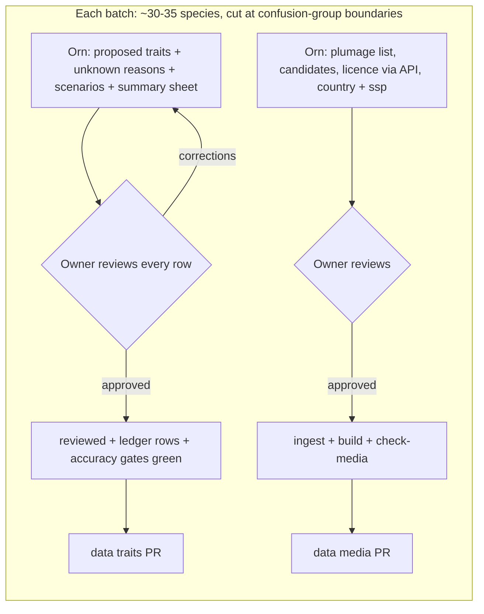

# 006 — Scale traits and photos to all 295 species in the guide (M8)
Status: Approved (owner, 2026-11-18)

## Problem
This guide holds a curated selection of 295 species, not the full Sri Lankan list. Step-by-step ID knows only the 34
pilot species with reviewed traits (spec 004), and only 20 species have photos (spec 003). When Emma (tourist) or Nimali
(Sinhala-first beginner) describe a bird outside the pilot, it never appears in the results, and Ruwan (guide) and
Kasun (student) see "No photo yet" on most pages. M8 (plan §7) is mostly a **data** milestone: repeat the reviewed M5
trait process and the M2 photo process in batches for the remaining 261 species in the guide. The code work is small:
a coverage ledger, budget checks, a lighter precache, and a richer accuracy test.

## User stories
- As Emma, I want step-by-step ID to consider every species in this guide, so the bird I saw can be in my results.
- As Nimali, I want a photo on most species pages, so I can match the bird without reading long English prose.
- As Ruwan, I want to see when a trait or photo is missing, so I know how far to trust a result.
- As Kasun, I want photos of the plumages that matter in Sri Lanka, so I can recognise the birds I actually meet.
- As the owner, I want to review every row of every batch, so nothing unchecked ships.

## Acceptance criteria
Trait coverage (after the last batch)
- Given `traits-batches.csv`, then all 295 species are listed with `reviewed_by` and `reviewed_at`. Only species in the
  ledger reach Identify. The footer reads "This guide can identify 295 of its 295 species" (Q9 wording).
- Given a ledger row, then each ID question (`zone`, `habitat`, `size`, `colour`, `behaviour`, `month`) and `commonness`
  either has at least one `reviewed` row, or appears in `unknown_traits`. A question can also be unknown for one
  plumage only, e.g. `colour:juvenile`. The validator fails when a question is in neither place or in both, and it
  rejects a row where all six questions are unknown. Each unknown has a reason in the batch sheet. The report flags any
  species with 2 or more unknown core questions.
- Given a species with unknowns and one that fully matches the same answers, then the species with unknowns never
  ranks higher (unit test).
- Given any trait row, then `source` uses the vocabulary format: `workbook:<column>`, `ext:<name>` (with a citation)
  or `expert:ornithologist`. Expert rows are low or medium confidence, with one exception: `expert:ornithologist,high`
  is allowed for `commonness` of very common birds (23 pilot rows use this today). `size` never comes from
  `expert:`. It uses a workbook length or a cited `ext:` reference with a page or URL. About 17 species lack a length.
- Given `commonness`, then it is drafted from a citable published status text as `ext:`, e.g. Warakagoda et al. 2012
  with the citation in the row, or the expert exception above.
- Given workbook values (names, Sinhala text, codes), then none are changed. Doubts go to `workbook-doubts.csv`.
- Given a batch review sheet, then it is generated from `traits.csv`, and CI fails if the two differ.

Photo coverage
- Given the manifest, then at least 280 of 295 species have at least 1 reviewed photo. The rest show "No photo yet".
  There is never another species' photo, an illustration or a search link.
- Given a species, then photos follow its "plumages that matter in Sri Lanka" list in the batch sheet (≤ ~4 colour-set
  plumages). Migrants show the plumage seen here first: non-breeding, or immature for large gulls. Breeding plumage is
  added only where it is commonly seen on arrival or departure. Gaps are listed with a reason and never block a batch.
- Given an endemic, then its photos are from Sri Lanka only. Visibly distinct Sri Lankan subspecies (e.g. Indian
  Blackbird *kinnisii*, Changeable Hawk-eagle *ceylanensis*, Common Myna *melanosternus*) use Sri Lankan or
  same-subspecies photos. Split-sensitive taxa match the local form (Lesser Black-backed Gull *heuglini* type, Eastern
  Cattle Egret, Eastern Barn Owl). Every candidate records its country and subspecies.
- Given CI, then every image has one `reviewed` licence row with author, licence and attribution (existing). NC rows
  are counted and flagged "replace before launch" (decision #18).

Responsible birding
- Given any photo, then its metadata is stripped (existing ingest). Given a species on `sensitive-species.csv`, then no
  committed sheet, note or credit names a site finer than its zone (decision #12).

ID accuracy (`id-test-sightings.csv`, gated per batch)
- The set has ≥ 100 sightings covering every plate. New columns: `scenario_source` and a test-only `hard_group`.
  At least ~20% of each batch's scenarios come from someone other than the trait drafter, or were written from plates
  or photos before the trait rows existed. At least ~60% target species that are common in at least one zone.
  Scarce and vagrant targets are reported but not gated. `scenario_source` is `drafter` (the trait drafter),
  `other` (someone else) or `plates` (written from plates or photos before the traits). A batch ≥ 1 whose mix is
  not met fails its accuracy check; batch 0 (the M5 pilot) is reported only. Hard-group members are the test targets
  that share a `hard_group`, so each lookalike needs its own sighting.
- The gates are:
  - overall top-5 ≥ 70% and top-10 ≥ 90%, valid only with the mix above;
  - easy scenarios top-5 ≥ 80%;
  - hard-group scenarios top-10 ≥ 80%, and any group member in the top 3 ≥ 90%;
  - the original 25 at top-5 ≥ 80%;
  - the 5 demo birds in the top 3.
- Given 295 species, then CI asserts results within the 1 s budget and logs the measured ranking average. The
  "< 10 ms" figure is a manual on-device target only (`rank.test` once flaked at 50 ms).

Offline and budgets
- Precache ≤ 10 MiB (hard, `build-sw.ts`), with a soft warning above 9 MiB. Thumbnails ≤ 4 MB (existing). Full pack
  ≤ 75 MB, masters ≤ 150 MB (new checks). `PHOTO_CACHE_MAX_ENTRIES` is above the image count, so pack photos are
  not evicted. Me → "Offline photo pack" shows the new size before download.
- Given airplane mode after first load, then all thumbnails, traits, plate pages and the full ID flow work with no
  failed request (existing Playwright tests, re-run on full data).

## UX
No new screens. The existing states cover M8: "No photo yet", hidden plumage tabs, "Data incomplete", "Not usually
here/now" and the footer. The only visible change is the footer wording (slice 5). Sinhala names that read
"තහවුරු කළ යුතුයි" display as-is (see Data).

## Data
Facts (repo, 2026-11-18):
- 295 species and 43 plates in `content/content.json`. Occurrence codes: R 174, M 63, E 35, R/M 19, R+M 3, R+(M) 1.
- Traits: `traits.csv` has 687 `reviewed` rows for 34 species (`traits-pilot.csv`, to be marked historical by slice 1a).
  261 species have none. `id-test-sightings.csv` has 25 sightings, 5 of them demo birds, all in the top 5
  (`traits-review.md` says 24; that is stale).
- Photos: `licences.csv` has 41 reviewed rows for 20 species. Measured averages: thumbnails 7 KB, masters 185 KB.
  Full images are 35–185 KB. `PHOTO_CACHE_MAX_ENTRIES` is 600.
- Prose: about 28 species are Sinhala-only, about 17 have no length, and about 20 juvenile cells are placeholders.
  Codes are pending verification.
- Seven Sinhala values are "තහවුරු කළ යුතුයි" ("to be confirmed"). Three are `names.si` (Siberian Sand-Plover,
  Sanderling, Common Kestrel) and four are plate titles (Ashy Drongo, Sri Lanka Brown-capped Babbler, Indian
  Blackbird, Indian Blue Robin). They are shown as-is and listed for the owner. A Sinhala name is never substituted.

Precache projection (architect, MiB):

| Item | Today | After 295 |
|---|---|---|
| Measured total | 5.61 | |
| `traits.json` in entry JS (~530 B/species) | | +0.14 |
| `media-manifest.json` in entry JS (~857 B/image × ~590) | | +0.45 |
| Pre-rendered `photo-credits.html` (~1.1 KB/credit) | | +0.6 |
| Thumbnails (275 × 7 KB) | | +1.9 |
| **Total before slice 3** | | **~8.9** (~10 at 12 KB thumbnails) |
| **After slice 3** (plate pages from one template, −1.7) | | **~7.2** |

Repo size: masters ≈ 590 × 185 KB ≈ 107 MB, plus ≈ 45 MB of derived WebP. Masters stay in plain git with no LFS.
The reasons: files are small and rarely change, LFS bandwidth quotas would hit CI and preview builds, and every
contributor would need extra tooling. If the projection after batch 2 exceeds ~130 MB, new masters switch to
1280 px q80 by an ADR 0004 amendment.

New data files:
- `traits-batches.csv`: `species_id,batch,unknown_traits,reviewed_by,reviewed_at,note`.
  `unknown_traits` is a `|` list of `traits.csv` trait names, optionally `trait:plumage_key`. Batch 0 is the 34 pilot species.
- `workbook-doubts.csv`: `species_id,field,doubt,suggested_source`. One running list. Codes are never changed.
- `sensitive-species.csv`: `species_id,reason`. It is seeded with Serendib Scops-owl, Black-necked Stork, Spot-bellied
  Eagle-owl, Legge's Hawk-eagle, Lesser Adjutant, tern and heron colony species, and trade-targeted species
  (parakeets, Hanging-parrot, Hill Myna, Shama). Each batch extends it.
- Per batch: `traits-review/batch-NN.md` (generated) plus the ornithologist's per-species summary, and
  `media/candidates/batch-NN.md` (plumage list, country, subspecies, gaps).

Who supplies what: the ornithologist drafts traits, unknown reasons, plumage lists, scenarios, candidates and doubts.
The owner reviews every row (decision #9). A second reviewer (CBC member or guide) for commonness and zones is
recommended but optional. No new Sinhala UI strings except the footer draft, which needs native review.

## Out of scope
- Sound ID, Photo ID, user uploads, sync (M7), illustrations.
- Native photos (thumbnails and pack): `mediaUrl()` is root-relative, so native shows no photos at all today.
- Fixing or translating workbook prose, names or codes. Similar-species cards, maps, month strips, "Use my location".
- Known limitations, not fixed in M8:
  - owls and nightjars rank weakly, because the vocabulary has no "at night" behaviour;
  - months for R/M species show "all", which overstates local presence.
- Thumbnails in Browse and Search rows (issue #102). Replacing NC images (before launch).

## PR slices
Code (C) slices land first and keep `main` green. Data (D) PRs are exempt from the 200-line rule, but each is one
reviewable batch. **Data PRs touch the same CSVs and generated JSON: merge them one at a time, rebasing and
regenerating before each merge.** `[Orn]` = ornithologist drafts. `[Owner]` = owner review before merge.
1a. C feat(content): `traits-batches.csv` ledger. Validation covers the FK, `unknown_traits` names and plumage keys,
    "neither or both", and all-six-unknown. Batch-0 back-fill and gating Identify on the ledger land in the same PR,
    with a test that the footer still says 34. `traits-pilot.csv` is marked historical (~150)
1b. C feat(content): per-question coverage report, flag for ≥ 2 unknown core questions, `traits.json` size log (~70)
2.  C chore(media): CI totals for the pack (≤ 75 MB) and masters (≤ 150 MB), the `public/media` total, and a photo
    coverage report. `PHOTO_CACHE_MAX_ENTRIES` derived from the manifest (or 1000). `build-sw.ts` warns above 9 MiB (~110)
3.  C perf(pwa): serve `plate/[id].html` from one template via a small imported SW fetch listener
    (generateSW allows one `navigateFallback`, used by species pages) (−1.7 MB),
    with a one-line ADR 0004 amendment and the offline e2e updated (~90)
4.  C test(identify): accuracy reporting per plate and batch (top-5, top-10, hard-group, easy, original 25, demo).
    Adds `scenario_source`/`hard_group` columns and composition checks, the unknowns-cannot-outrank test, and a logged
    perf average. The real-traits test already exists in `accuracy.test.ts` (~140)
5.  C fix(identify): footer reads "species in this guide", with en and si drafts for native review (~20)
6.  C chore(content): `workbook-doubts.csv` and `sensitive-species.csv` with FK validation, seeded (~80)
7.  C feat(content): generate `traits-review/batch-NN.md` from `traits.csv`, with a CI match check (~150)
8.  D batches 1–8 in plate order, cut at confusion-group boundaries (~30–35 species each). Batches 2–4 (shorebirds,
    terns, raptors) are expected to be slowest. Each batch has two PRs:
    - `data(traits)`: rows, unknowns and reasons, scenarios, doubts and sensitive additions; reviewed inside the PR;
      gates green [Orn] [Owner] (~650 rows)
    - `data(media)`: candidates sheet, then reviewed `licences.csv` rows, masters and output [Orn] [Owner]
      (~70 images). Batch 1 also back-fills country and subspecies for the 41 pilot images.
9.  C feat(identify): retune weights or commonness tie-breaks **only if** a batch misses a gate [Orn] (~80–150, conditional)
10. C perf(pwa): lazy-load the manifest's credit block (optional, only if the precache needs headroom) (~100)
11. D docs(specs): ledger 295/295, final numbers, spec marked Done (~20)

Order: 1a → 1b → 2 → 3 → 4 → 5/6/7 (any order) → batches. Effort [Assumption]: about 8 code slices of 0.5–1 day each.
Per batch: about 1 agent-day of traits and about 0.5–1 of photos, plus about 3–5 owner hours. About 16 data PRs and
about 30–40 owner hours in total, about 4 weeks elapsed. Owner review is the limit.

## Risks
- R1 Photo gaps: these are mostly in restricted-range endemics (Serendib Scops-owl, Sri Lanka Thrush, Sri Lanka
  Whistling-thrush, Sri Lanka Bush Warbler, Sri Lanka Spurfowl), where Sri Lankan-only photos are required, and in
  female and juvenile plumages. Vagrants are probably only 0–3. Mitigation: "No photo yet", NC flagged, gaps listed.
- R2 Reviewer bandwidth (~5,200 rows, ~550 images): the full review stays. Each sheet opens with a per-species summary
  and focus areas: expert-sourced rows, low-confidence rows, endemics, hard groups and migrant months.
- R3 Repo size: ~150 MB projected. Slice 2 totals and the 1280 px fallback after batch 2.
- R4 Ranking regressions: more ties among similar species. Per-batch gates, hard-group scoring, conditional slice 9.
- R5 Precache: ~8.9 MiB without slice 3. Slice 3 is unconditional, slice 2 adds the soft warning, slice 10 is optional.
- R6 Data quality: prose is pending verification and partly Sinhala-only. Blanks stay unknown, sources are cited, and
  doubts are logged, never fixed.
- R7 Self-confirming tests: the drafter writes most scenarios. Mitigation: the `scenario_source` share rule.

## Decisions (owner, 2026-11-18)
1. **Batch order**: plate order (cut at confusion-group boundaries).
2. **Plumages**: one photo per plumage that differs, at least 1 per species, following the per-species
   "plumages that matter in Sri Lanka" list. Gaps never block a batch.
3. **Thumbnails**: precache all 295. Full images stay CacheFirst on demand.
4. **Review**: the owner reviews every row of every batch, helped by the summary sheet and focus areas.
5. **Photo target**: ≥ 280 of 295 species, with "No photo yet" for the rest. Photos from outside Sri Lanka are allowed,
   except for endemics and distinct Sri Lankan subspecies, with country and subspecies recorded.
6. **PRs per batch**: two (traits, media), with proposed rows reviewed inside the PR.
7. **Accuracy**: top-5 ≥ 70% and top-10 ≥ 90% overall, with the sub-gates above.
8. **Photo pack**: 75 MB budget, Wi-Fi-only default, no UI change.
9. **Footer**: kept, worded as "species in this guide".

## Revisions
- 2026-11-18: owner approved Q1–Q9. Folded in the architect review: precache projection, unconditional
  plate-template slice, perf assertion, source format, cache entries, ledger split, repo size, native photos, merge
  order. Folded in the ornithologist review: curated-list wording, source and size rules, plumage rule, scenario mix
  and hard groups, unknown reasons, photo origin, sensitive species, Sinhala placeholders, doubts list, generated
  review sheet, commonness sources, risks.

## Open questions (new, for the owner)
1. eBird cross-check of commonness and zones by the reviewer only (nothing ships from eBird): **default no**, because
   decision #14 still holds.
2. Footer wording: **"This guide can identify {count} of its {total} species"**. The si draft goes in slice 5 for
   native review. Do you accept it, or prefer another wording?
3. Second reviewer (CBC member or guide) for commonness and zones: **optional; proceed without one** unless you can
   name someone?
4. The 7 "තහවුරු කළ යුතුයි" Sinhala values: **leave them as-is in M8**, and correct them in the workbook when you have
   confirmed names?
